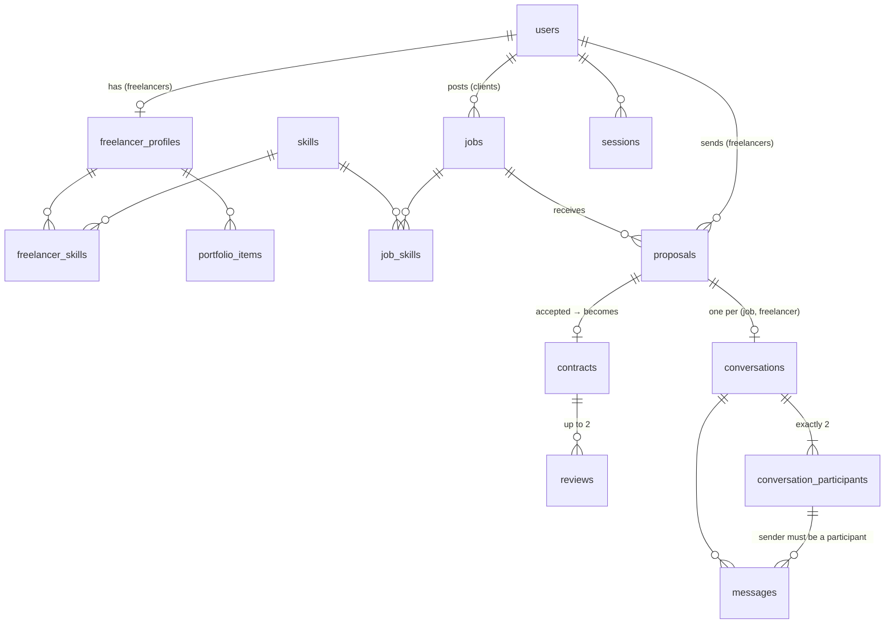
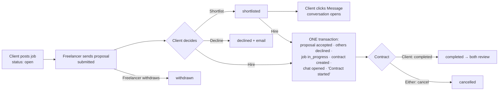

# Gigroom

**Day 24 of my 30-day dev challenge: a freelancer marketplace.** Learning focus: **profiles, proposals and messaging.**

Clients post jobs with a budget in naira. Freelancers build a profile and send proposals with a price, a timeline and a cover letter. The client shortlists, chats with freelancers, and hires one in a click, which creates a contract. When the work is done, both sides review each other. Every conversation is private to the two people in it.

- **Stack:** Next.js 16 (App Router, Cache Components) · TypeScript · Tailwind CSS v4 · PostgreSQL on Neon (plain SQL, no ORM) · Zod · Resend
- **Colours:** white 60% · purple `#4B1F7A` 30% · lavender `#E9E1F8` 10%, with light and dark mode

---

## 1. Run it locally

You need Node.js 20.12 or newer and a Neon account.

```bash
npm install
cp .env.example .env.local     # then fill in the values (see section 2)
npm run db:migrate             # creates the tables (safe to run twice)
npm run db:seed                # demo accounts, jobs, proposals, chats (safe to run twice)
npm run check:marketplace      # proves the rules; should print "26 passed, 0 failed"
npm run dev                    # http://localhost:3000
```

On Windows with Git Bash, these commands work as they are.

## 2. Connections and environment variables

| Variable | Required | What it is |
|---|---|---|
| `DATABASE_URL` | Yes | Neon **pooled** connection string. In Neon: create a project (region **AWS Europe (Frankfurt)**), then *Connect* → tick *Connection pooling* → copy. |
| `APP_URL` | Yes | `http://localhost:3000` locally; your live URL on Vercel. Used in email links. |
| `RESEND_API_KEY` | No | From Resend → *API Keys*. Empty = emails are printed in the terminal. |
| `EMAIL_FROM` | No | `Gigroom <onboarding@resend.dev>` until you verify your own domain in Resend. |
| `SEED_USER_PASSWORD` | For seeding | Password for every seeded client and freelancer (8+ characters). |
| `SEED_ADMIN_PASSWORD` | For seeding | Password for the seeded admin (8+ characters). |

**Resend notes.** Until you verify a domain, Resend only delivers to the email address you signed up to Resend with, from `onboarding@resend.dev`. To test real emails, sign up in Gigroom with that address. Seed and demo accounts use `@example.com` addresses, and the app never sends to those (they'd bounce); their emails are printed in the terminal.

## 3. Deploy to Vercel

1. Push this folder to GitHub as `30days-24-freelancer-marketplace`.
2. In Vercel: *Add New → Project* → import the repo.
3. Add every variable from section 2. Set `APP_URL` to the Vercel URL. You can skip the `SEED_*` variables; they're only used on your machine.
4. In *Settings → Functions*, set the region to **Frankfurt (fra1)**, close to the Neon database.
5. Deploy. Migrate and seed from your machine with `DATABASE_URL` pointing at the same Neon database.

No cron job is needed. Old demo data is cleaned up each time someone starts a new demo.

## 4. Demo accounts

After `npm run db:seed`. Every seeded account uses `SEED_USER_PASSWORD`, except the admin.

| Role | Email | Has |
|---|---|---|
| Client | `ngozi.client@example.com` | A shortlisted proposal and an open chat, an active contract, a completed contract |
| Client | `bello.client@example.com` | A completed contract with reviews both ways |
| Client | `funke.client@example.com` | Several open jobs with proposals |
| Freelancer | `amaka.dev@example.com` | Shortlisted, with a chat |
| Freelancer | `yusuf.design@example.com` | Hired on an active contract |
| Freelancer | `ifeoma.data@example.com` | Completed contract with a 5★ review |
| Freelancer | `seun.writer@example.com`, `musa.video@example.com`, `kemi.mobile@example.com` | Profiles and proposals |
| Admin | `admin@example.com` (`SEED_ADMIN_PASSWORD`) | The admin panel |

Or use **Try as a client** / **Try as a freelancer** on the home page. Each click creates a private world just for you: jobs, proposals and chats with demo people. Demo data is hidden from the public board and directory and deleted after 24 hours.

## 5. Diagrams

### Database schema



### From job to contract



### How a message travels (polling)

```mermaid
sequenceDiagram
  participant A as Client's browser
  participant S as Server
  participant DB as Postgres
  participant F as Freelancer's browser
  A->>S: POST /api/conversations/:id/messages {body, nonce}
  S->>DB: am I a participant? INSERT ... ON CONFLICT (sender, nonce) DO NOTHING
  S-->>A: 201 {message}
  S--)F: email, only if this is their FIRST unread message
  loop every 3 s while the tab is visible (15 s when hidden)
    F->>S: GET /messages?after=<last id>
    S->>DB: WHERE conversation_id = $1 AND id > $2  (index scan)
    S-->>F: [] or [new messages]
  end
  F->>S: POST /read {upTo}  (moves the read pointer; badge drops)
```

## 6. Who can see and change what (the ownership checks)

Every service function takes the acting user as its first argument and checks two things: **who you are** (role) and **whether the record is yours**. The ownership check is part of the SQL query itself (`... WHERE id = $1 AND client_id = $2`), so there's no separate step that could be forgotten. Someone else's record by id returns **404 Not found**, not 403, so nobody can probe which ids exist.

**Service layer (`lib/services/`)**

- [x] Only clients can post, edit or close jobs, and only their own (`lockOwnJob` in `jobs.ts`).
- [x] Only freelancers with a finished profile can send proposals; one per job; never to a job that isn't open (`submitProposal`).
- [x] A freelancer can edit or withdraw only their own proposal, and only while it's undecided (`lockOwnProposal`).
- [x] Only the job's client can list, shortlist, decline or accept its proposals (`lockProposalForClient`).
- [x] Only a client can **start** a conversation, and only with someone who applied to their job. No cold messages from freelancers.
- [x] Only the two participants can read or post in a conversation. **Admins can't read messages.**
- [x] A contract is visible to its two parties and admins. Only the client can mark it completed; either side can cancel.
- [x] Reviews only after completion, once per side, and the reviewee is worked out on the server (never taken from the form).
- [x] Closed jobs are hidden from strangers but still visible to their client and applicants.
- [x] Suspended users are logged out everywhere and can't log back in.

**Database layer (`db/migrations/002_gigroom.sql`): rules the database enforces even against a hand-written INSERT**

- [x] `UNIQUE (job_id, freelancer_id)` on proposals: one proposal per freelancer per job.
- [x] Partial unique index `proposals_one_accepted_per_job` and `contracts.job_id UNIQUE`: at most one hire per job.
- [x] Composite foreign key `contracts (job_id, client_id) → jobs (id, client_id)`: a contract's client must own the job.
- [x] Composite foreign key `contracts (proposal_id, job_id, freelancer_id) → proposals`: the freelancer must be the proposal's author.
- [x] Composite foreign key `conversations (job_id, freelancer_id) → proposals`: you can only chat about a job you applied to.
- [x] Composite foreign key `messages (conversation_id, sender_id) → conversation_participants`: only participants can post.
- [x] `UNIQUE (sender_id, client_nonce)` on messages: a retried send is never stored twice.

`npm run check:marketplace` tests all of these against the real database.

## 7. Key decisions, explained

**Why polling instead of WebSockets.** Vercel functions can't keep a socket open, so real-time push would need an extra service (Pusher, Ably, Supabase Realtime). Polling is free and simple, and it's cheap here because "messages after id N" is one index lookup that's usually empty. It slows to every 15 seconds in a hidden tab and backs off on errors. The cost is up to 3 seconds of delay and more small requests. That's fine for job chat; a live trading app would need push.

**Why message ids are `bigserial`.** Ids only go up, so "after id 1042" is a reliable way to ask for new messages, and "how far have I read" is a single number per person (`last_read_message_id`). Marking a whole thread as read is one UPDATE, and unread = messages with a bigger id that aren't mine.

**Why a nonce on every message.** The browser makes a random UUID for each message. If the network drops after the server saved it, pressing Retry sends the same nonce, and `ON CONFLICT DO NOTHING` returns the saved message instead of creating a duplicate.

**Why one email per unread streak.** The recipient is emailed only when a message is their *first* unread one in that chat. Ten quick messages = one email.

**Why accepting is one transaction with row locks.** `SELECT ... FOR UPDATE OF p, j` locks the proposal and its job, so two tabs hiring two different people for the same job run one after the other. The second sees "You've already hired for this job". The unique indexes are the safety net. The check script fires 10 accepts at once and expects exactly 1 contract.

**Why proposals take `FOR SHARE` on the job.** Many freelancers can apply at the same time (shared locks don't block each other), but a close or a hire (which take `FOR UPDATE`) waits, so a proposal can never land on a job that just closed.

**Why keyset pagination.** `OFFSET 1200` makes Postgres read and discard 1,200 rows, and new posts shift every page. A cursor of `(created_at, id)` or `(budget, id)` is an index seek at any depth, and the `id` tie-breaker means no job is skipped or repeated. A tampered cursor is ignored, not a crash.

**Why `proxy.ts` only checks that a cookie exists.** It gives a real HTTP redirect to `/login` before anything renders. It doesn't validate the session (a cookie can be expired or forged), so every page and service still checks properly.

**Why Cache Components matters here.** Next.js 16 prerenders everything it can into a static shell. Anything that reads cookies or the database sits behind a `<Suspense>` boundary and streams in. That's why each page is `<Suspense fallback={skeleton}><Content/></Suspense>`, and why the header's user menu streams in separately.

**Money.** Integer kobo in `bigint` columns, parsed from what people type without ever going through a float (`parseNairaToKobo`), and displayed with `Intl.NumberFormat("en-NG", { currency: "NGN" })`. A contract copies the bid at the moment of hiring, so later edits can't change the agreed amount.

**Colour.** Purple carries the structure (top bar, dashboard sidebar, hero band, headings, buttons, your own message bubbles). Lavender is only ever a background (tags, selected filters, the other person's bubbles, unread rows). Body text is a near-black ink, because long paragraphs in purple are tiring to read. All text pairs pass WCAG AA in both modes; the ratios are listed at the top of `app/globals.css`. Statuses always show a word and an icon, never colour alone.

## 8. Where each concept lives

| Concept | File | One-line explanation |
|---|---|---|
| Ownership in the query | `lib/services/proposals.ts` (`lockProposalForClient`) | `WHERE p.id = $1 AND j.client_id = $2 FOR UPDATE`: check and lock in one step |
| Hire = one transaction | `lib/services/proposals.ts` (`acceptProposal`) | Accept, decline others, contract, chat, system message: all or nothing |
| Composite foreign keys | `db/migrations/002_gigroom.sql` | The database refuses contracts and messages that break ownership |
| One-accepted-per-job | `db/migrations/002_gigroom.sql` | Partial unique index `WHERE status = 'accepted'` |
| Conversations and read pointers | `lib/services/messages.ts` | Participants table, `last_read_message_id`, unread counts |
| Idempotent sending | `lib/services/messages.ts` (`sendMessage`) | `ON CONFLICT (sender_id, client_nonce) DO NOTHING` |
| Polling with back-off | `components/thread.tsx` | 3 s visible, 15 s hidden, doubles on errors, max 30 s |
| Optimistic send and Retry | `components/thread.tsx` | Shows "Sending…", keeps the nonce for a safe retry |
| Live unread badge | `components/unread-badge.tsx`, `app/api/unread/route.ts` | Polls every 20 s, refreshes instantly after reading |
| Email throttling | `lib/services/messages.ts` (`notifyRecipient`) | Email only for the first unread message |
| CSRF protection for JSON routes | `lib/api.ts` (`sameOrigin`) | `Sec-Fetch-Site` / `Origin` check plus SameSite=Lax cookies |
| Search in one safe query | `lib/services/jobs.ts` (`searchJobs`) | Fixed SQL fragments, values only as `$n` parameters |
| Keyset pagination | `lib/services/cursor.ts`, `jobs.ts`, `profiles.ts` | `(sort value, id) < cursor`, stable and fast |
| Full-text search | `002_gigroom.sql` (generated `search` columns) | `tsvector` kept in sync by Postgres, GIN index |
| URL state for filters | `app/jobs/page.tsx`, `lib/validation.ts` | Zod with `.catch()`: bad URL values fall back to defaults |
| Validation | `lib/validation.ts` | One Zod schema per form, route and search |
| Accessible forms | `components/form.tsx` | Focused error summary, `aria-describedby`, kept values |
| Sessions | `lib/auth/session.ts`, `lib/auth/sessions.ts` | Random token in an httpOnly cookie; only its hash is stored |
| Passwords | `lib/auth/password.ts` | scrypt with a random salt, constant-time compare |
| Rate limiting | `lib/auth/rate-limit.ts` | One atomic upsert in Postgres, works across serverless instances |
| Fast auth redirect | `proxy.ts` | Cookie-presence check before rendering |
| Streaming with Cache Components | every `app/**/page.tsx` | Request-time data behind `<Suspense>` |
| Demo mode | `lib/services/demo.ts` | Private demo world, cleaned with one cascading DELETE |
| Admin with audit log | `lib/services/admin.ts` | Suspend, restore, take down; every action recorded |
| Money in kobo | `lib/money.ts` | Integer maths, no floats |
| Design tokens and dark mode | `app/globals.css` | CSS variables mapped into Tailwind's `@theme` |
| Proof | `scripts/check-marketplace.ts` | 26 rule checks against the real database |

## 9. Project layout

```
app/                 pages, Server Actions (actions/*), JSON routes (api/*)
components/          form kit, thread, cards, header, dashboard nav
lib/db.ts            connection pool and q() / q1() / tx() helpers
lib/services/        the rules; every function takes the acting user first
lib/auth/            passwords, sessions, rate limiting
lib/validation.ts    Zod schemas
db/migrations/       001_auth.sql, 002_gigroom.sql
scripts/             migrate, seed, check-marketplace
proxy.ts             quick logged-in check for dashboard routes
```

## 10. Out of scope (worth adding later)

Payments and escrow (Paystack split payments come on Day 25), file attachments in chat, milestones, password reset and email verification, invitations from clients to specific freelancers, saved jobs, typing indicators and read receipts, real-time push (Ably or Pusher) instead of polling, profile photos, and automated tests beyond the check script.
